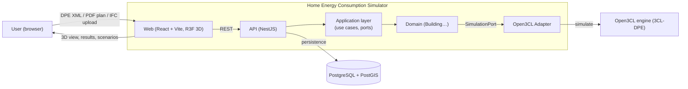
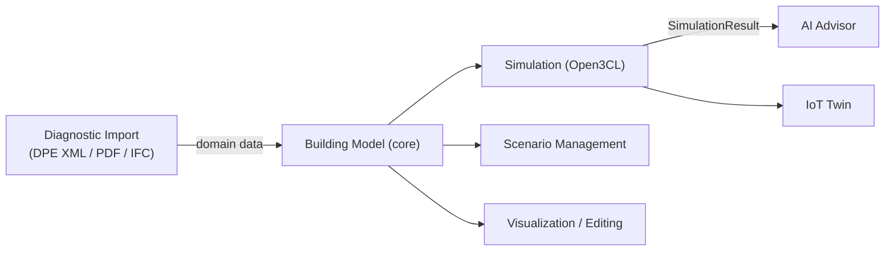

# Architecture — Home Energy Consumption Simulator

## 1. Architecture Principles

- **Clean Architecture / Hexagonal Architecture:** dependencies point inward; the domain never depends on frameworks or infrastructure.
- **Domain-Driven Design:** a `Building`-centric model with explicit bounded contexts and ubiquitous language (DPE terminology).
- **SOLID** and **dependency injection** everywhere; ports and adapters for all external systems.
- **Open3CL is the single source of truth** for energy calculations (see `docs/decisions/ADR-0001-open3cl-as-core-engine.md`).

## 2. System Context

## 3. Bounded Contexts

| Context | Responsibility | Key concepts |
| --- | --- | --- |
| **Diagnostic Import** | Parse DPE XML, PDF floorplans, IFC files into domain data | `ImportJob`, `ImportReport`, inferred-value metadata |
| **Building Model** (core) | Canonical representation of the dwelling | `Building`, `Zone`, `Room`, `Wall`, `Roof`, `Floor`, `Window`, `Door` |
| **Thermal & Systems** | Thermal zones and equipment | `ThermalZone`, `HeatingSystem`, `VentilationSystem`, `PhotovoltaicSystem` |
| **Simulation** | Run Open3CL, store results | `SimulationPort`, `SimulationResult`, `SimulationJob` |
| **Scenario Management** | Renovation scenarios and comparison | `Scenario`, `ScenarioComparison` |
| **Visualization** | 3D rendering of the building and heat losses | read-only projections over the Building Model |
| **Editing** | Mutations of the building with confidence tracking | commands, validation, audit of inferred values |
| **AI Advisor** (future) | Renovation recommendations grounded in simulation deltas | `Recommendation` with confidence score |
| **IoT Twin** (future) | Real telemetry vs simulated consumption | `Measurement`, `DigitalTwinSync` |

Context map:

## 4. Domain Architecture

- **Aggregate root:** `Building`. It owns zones, rooms, and envelope elements (`Wall`, `Roof`, `Floor`, `Window`, `Door`) and guarantees invariants (e.g., a room belongs to exactly one zone).
- **Value objects:** dimensions, materials, U-values, orientations, `{ value, source, confidence, importDate }` confidence wrapper.
- **Domain services:** reconstruction rules (inferring missing geometry), scenario diffing.
- **Domain events:** `BuildingImported`, `BuildingUpdated`, `SimulationCompleted`, `ScenarioCreated` — used for audit and future IoT sync.
- The domain layer is **framework-free** and fully unit-testable.

## 5. Application Architecture

- Use cases per bounded context, e.g. `ImportDpeXmlUseCase`, `ReconstructBuildingUseCase`, `RunSimulationUseCase`, `CompareScenariosUseCase`, `UpdateWallUseCase`.
- **Ports** (interfaces) defined in the application layer: `BuildingRepository`, `DpeImporterPort`, `SimulationPort`, `ScenarioRepository`.
- Application layer depends only on the domain; infrastructure implements the ports (dependency inversion).
- **Implemented in P1:** `ImportDpeXmlUseCase` / `GetBuildingUseCase` with ports `DpeImporterPort` (implemented by `packages/dpe-xml-importer`) and `BuildingRepository` (implemented by `packages/postgres-repository`), exposed by `apps/api` as `POST /imports/dpe` and `GET /buildings/:id`. Mapping doc: [phases/P1-import-mapping.md](phases/P1-import-mapping.md).
- **Implemented in P2:** `RunSimulationUseCase` / `GetSimulationHistoryUseCase` / `GetSimulationUseCase` / `GetSimulationJobUseCase` + `SimulationJobRunner`, with ports `SimulationPort` (extended with `simulateBuilding(building)`; implemented only by `packages/open3cl-adapter`) and `SimulationRepository` (Postgres schema v2 + in-memory), exposed as `POST /buildings/:id/simulations`, `GET /buildings/:id/simulations`, `GET /simulations/:id`, `GET /simulations/jobs/:id`. Mapping doc: [phases/P2-simulation-mapping.md](phases/P2-simulation-mapping.md).
- **Implemented in P3:** `ReconstructBuildingUseCase` with the new `GeometryPort` (implemented by `packages/geometry` on top of the domain `ReconstructionService`), exposed as `GET /buildings/:id/geometry` (deterministic `Geometry` JSON + mesh hash; coordinate system and inference rules: [geometry.md](../geometry.md)). The heat-loss overlay is a read-only projection of the persisted `SimulationResult` (`projectHeatLoss` in the domain, fed by P2's `GET /buildings/:id/simulations`).
- **Implemented in P4 (2D-first editor):** `EditBuildingUseCase` / `UndoLastChangeUseCase` / `GetAuditLogUseCase` with the `AuditLog` port and an additive optimistic-locking `BuildingRepository.update` (Postgres schema v3: `buildings.version` + append-only `audit_entries`), exposed as `PATCH /buildings/:id` (`If-Match: version` → 409), `GET /buildings/:id/audit`, `POST /buildings/:id/undo`. Edits are versioned domain commands (`packages/domain/src/commands.ts`, vocabulary v1 shared with P5) applied purely by `Building.apply` and stored with `Confidence { source: "user", confidence: 1.0 }`; re-simulation after an edit goes through the P2 endpoint. The adapter re-simulates edited buildings by overlaying only the `source: "user"` fields onto the retained `sourceDpeXml` at the engine's `*_saisi` patch points (`packages/open3cl-adapter/src/map-building-to-engine-input.ts`), so user edits change the engine input and the result; field-wise reconstruction stays the fallback for buildings without a retained source.

## 6. Infrastructure Architecture

- **API:** NestJS application exposing REST endpoints; controllers are thin and delegate to use cases.
- **Web:** React + Vite + React Three Fiber + Three.js for 3D; Zustand for state; Material UI for components. No business logic in components.
- **Persistence:** PostgreSQL + PostGIS; schema and migrations versioned under `infrastructure/postgres`.
- **Adapters:** `packages/dpe-xml-importer`, `packages/pdf-floorplan-importer`, `packages/ifc-importer`, `packages/open3cl-adapter`.
- **Docker Compose** provides the full stack (API, web, database) both locally and on a dedicated server — see [deployment](deployment.md).
- **Deployment model:** self-hosted via Docker Compose; the Open3CL engine runs embedded, so no external simulation service is required.

## 7. Open3CL Integration Strategy

- `SimulationPort` (application) declares `simulate(dpeXml: string)` (P0) and `simulateBuilding(building: Building)` (P2).
- `packages/open3cl-adapter` is the **only** module allowed to import the Open3CL engine. It maps the domain `Building` to the engine input (XML/JSON), executes the engine, and maps the output to `SimulationResult`.
- The engine version is **pinned**; contract tests run against real DPE fixtures from the engine's test corpus.
- Flow: `Building → Open3CL Adapter → Open3CL → SimulationResult`. No alternative engine, no local re-implementation of 3CL formulas.
- Performance budget: simulation < 3 s. Results are cached by input hash; long runs are executed as queued jobs.

## 8. Future Scalability Strategy

- **Stateless API** instances behind a reverse proxy; horizontal scaling of the NestJS API.
- **Async simulation jobs** on a queue with dedicated workers, so the API stays responsive.
- **PostgreSQL read replicas** for reporting; PostGIS for geo-spatial queries (building location, climate zones).
- **Caching** of simulation results and static 3D assets via CDN.
- **Event-driven extensions** (domain events) to plug in the AI Advisor and IoT Twin without touching the core.
- Frontend served as static assets; 3D tiles/geometry streamed on demand.
