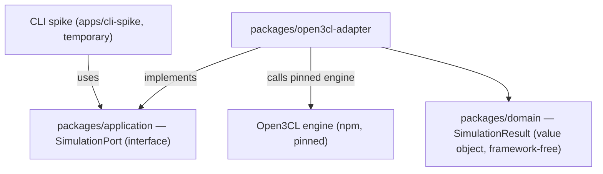

# Phase Overview

| Field | Value |
| --- | --- |
| Phase | P0 — Open3CL Feasibility |
| Status | Planned |
| Team | 1 backend engineer, 1 software architect (part-time) |
| Depends on | Nothing — this is the entry phase |
| Blocks | P1 and, transitively, the entire roadmap |

P0 is a de-risking spike, not a product phase. Its single question: **can the Open3CL engine be embedded in this platform and meet the < 3 s simulation budget on real DPE files?** Everything else is built on this answer.

Canonical prompt to start a Vibe session for this phase: [P0-vibe-prompt.md](P0-vibe-prompt.md).

# Objective

Prove, with executable evidence, that:

1. The Open3CL engine can be installed as a pinned dependency and called from TypeScript under strict mode.
2. A real French DPE XML file can be simulated end-to-end and produce consumption, emissions, and energy/climate labels identical to the engine's own output.
3. The p95 simulation latency on a reference machine is under 3 seconds.
4. The monorepo scaffolding (Clean Architecture / Hexagonal packages, CI) is in place for all later phases.

# Business Value

- **Fail fast:** if Open3CL cannot be embedded reliably, the project learns it in weeks, not years, before any UI or importer work is invested.
- **Regulatory anchor:** ratifies ADR-0001 with benchmarks instead of assumptions — the platform's credibility rests on Open3CL being the single source of truth.
- **Foundation:** the package layout, CI, and test conventions created here are reused by every later phase.

# Scope

**In scope**

- Monorepo scaffolding: `apps/` (empty shells), `packages/domain`, `packages/application`, `packages/open3cl-adapter`, `infrastructure/docker`, `tests/e2e` placeholders.
- TypeScript strict configuration, ESLint, Vitest, CI workflow (lint + typecheck + unit tests on every PR).
- `SimulationPort` interface in the application layer and a working adapter in `packages/open3cl-adapter`.
- A CLI spike: `simulate <dpe.xml>` prints the engine result as JSON.
- Benchmark harness over a fixture corpus of real DPE XML files (taken from the engine's own test corpus).
- ADR-0001 finalized with measured numbers.

**Out of scope**

- DPE parsing into the domain model (P1), API endpoints, UI, database schema, scenario logic.

# Functional Requirements

- FR-P0-01: Given a path to a DPE XML file, the CLI returns the engine's consumption, emissions, and label results as JSON on stdout.
- FR-P0-02: The CLI exits non-zero with a clear error on malformed input.
- FR-P0-03: The benchmark harness runs N fixtures and reports p50/p95/max latency plus a pass/fail against the 3 s budget.

# Technical Requirements

- TR-P0-01: TypeScript strict mode in every package; no `any` without written justification.
- TR-P0-02: Open3CL engine dependency pinned to an exact version in the workspace root; upgrades are deliberate PRs.
- TR-P0-03: `packages/open3cl-adapter` is the **only** package importing the engine (enforced by ESLint `no-restricted-imports`).
- TR-P0-04: Dependencies point inward: `domain` ← `application` ← `adapter`; the domain has zero framework imports.
- TR-P0-05: CI runs on every PR: ESLint, `tsc --noEmit`, Vitest. Minimum 80% coverage on new code.
- TR-P0-06: Benchmark runs on a documented reference machine (CPU/RAM recorded in the report).

# Architecture

The adapter maps an engine-native DPE document to `SimulationResult`. No domain `Building` model yet — that is P1's job; P0 only proves the engine boundary.

# Domain Model Impact

- Introduces `SimulationResult` value object: `{ consumptionKwh, emissionsKg, energyLabel, climateLabel, rawEngineOutput }`.
- Introduces the `SimulationPort` interface in the application layer: `simulate(dpeDocument): Promise<SimulationResult>`.
- No `Building` aggregate yet.

# Deliverables

1. Monorepo scaffolding with strict TS, lint, Vitest, CI workflow.
2. Working `open3cl-adapter` + CLI spike.
3. Benchmark report (`docs/phases/P0-benchmark-report.md`) with latency distribution and fixture list.
4. ADR-0001 updated with measured results; status Accepted.
5. Go/no-go recommendation signed by the architect.

# Dependencies

**Must be completed before this phase starts:** nothing — entry phase. External prerequisites: Node.js LTS, pnpm/npm, access to the Open3CL engine package and its public DPE test corpus. Fixture supply: the project owner provides an actual DPE XML and the other files published by ADEME (including the DPE report); they join the corpus after privacy/anonymization review.

# Test Plan

## Unit Tests

- Adapter maps engine output fields to `SimulationResult` without loss (field-by-field assertions).
- Error mapping: engine throws → domain error type, non-zero CLI exit.

## Integration Tests

- For each fixture DPE XML: run via adapter, compare JSON output **byte-for-byte** with a direct engine call on the same file. Any diff fails the test.
- Benchmark harness executes the full corpus and emits the latency report.

## Acceptance Tests

- AC-P0-01: ≥ 10 real DPE fixtures simulate successfully.
- AC-P0-02: 100% of adapter outputs identical to direct engine outputs.
- AC-P0-03: p95 latency < 3 s on the reference machine.
- AC-P0-04: CI green on the scaffolding PR (lint, typecheck, tests, ≥ 80% coverage).

# Risks

| Risk | Level | Mitigation |
| --- | --- | --- |
| Engine API changes between versions | Medium | Pin version; contract tests; subscribe to upstream releases |
| Latency above 3 s budget on large dwellings | Medium | Benchmark early; profile; cache by input hash later (P2) |
| Engine test corpus not representative of production DPEs | Low | Add our own anonymized fixtures as they arrive (P1) |
| License incompatibility | Low | Engine is MIT; legal check recorded in ADR-0001 |
| Node version drift breaks engine | Low | `.nvmrc` pinned; CI uses the same version |

# Acceptance Criteria

All AC-P0-01…04 pass on `main`, the benchmark report is published, and ADR-0001 carries the measured numbers.

# Exit Criteria

**Must be completed before P1 starts:**

1. Scaffolding merged to `main` with green CI.
2. Benchmark report approved; p95 < 3 s demonstrated.
3. ADR-0001 Accepted.
4. `SimulationPort` interface frozen (later phases extend, never break, it).
5. Fixture corpus checked in under `packages/open3cl-adapter/test/fixtures/` — the engine's test corpus plus the owner-provided ADEME DPE XML and DPE report.

# Branch Name

`feature/P0-open3cl-feasibility`

# Definition of Done

- [ ] CLI spike simulates every fixture without error
- [ ] Adapter output identical to engine output on 100% of fixtures
- [ ] p95 latency < 3 s, report published
- [ ] ADR-0001 Accepted with measurements
- [ ] CI enforces lint + typecheck + tests + 80% coverage on every PR
- [ ] ESLint rule blocks engine imports outside `open3cl-adapter`
- [ ] Go/no-go decision recorded and communicated
