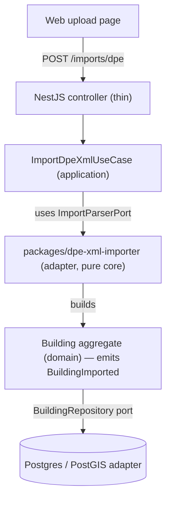

# Phase Overview

| Field | Value |
| --- | --- |
| Phase | P1 — DPE XML Import |
| Status | Planned |
| Team | 2 backend engineers, 1 frontend engineer, 1 domain expert (DPE) |
| Depends on | P0 exit criteria (scaffolding, ADR-0001, frozen fixture corpus, green CI) |
| Blocks | P2, P3, P4 and everything downstream |

P1 builds the platform's front door: importing a French DPE XML file into the canonical `Building` domain model, with full confidence metadata on every inferred value.

Canonical prompt to start a Vibe session for this phase: [P1-vibe-prompt.md](P1-vibe-prompt.md) (requires PR #6 / Phase P0 merged on `main` first).

# Objective

Allow a user to upload a DPE XML file and obtain a persisted, validated `Building` aggregate plus an import report listing every field that was missing and inferred — in under 1 second.

# Business Value

- The DPE file is the only input most French homeowners already have; importing it is the zero-friction entry point of the whole product.
- Confidence metadata (`value / source / confidence / importDate`) is what makes the platform trustworthy: users can see what is measured vs inferred.
- A solid import unlocks simulation (P2), 3D (P3), editing (P4), and scenarios (P5).

# Scope

**In scope**

- `packages/dpe-xml-importer`: schema validation + mapping to the domain.
- Domain `Building` aggregate and all envelope/system entities.
- `Confidence<T>` value object applied to every imported or inferred field.
- PostgreSQL/PostGIS schema v1 + migrations; `BuildingRepository` port + Postgres adapter.
- NestJS module + `POST /imports/dpe` endpoint (multipart upload).
- Minimal web upload page (file picker → import report view).
- Import report: parsed fields, inferred fields with confidence, unparsed/unknown fields.

**Out of scope**

- PDF and IFC import (P6, P7), 3D view (P3), simulation endpoint (P2), editing (P4).

# Functional Requirements

- FR-P1-01: Upload a DPE XML file via `POST /imports/dpe`; receive `{ buildingId, report }`.
- FR-P1-02: The file is validated against the DPE XML schema before mapping; invalid files return HTTP 422 with the schema errors.
- FR-P1-03: The XML is mapped to a `Building` aggregate (zones, rooms, walls, roofs, floors, windows, doors, thermal zone, heating/ventilation/PV systems).
- FR-P1-04: Every value not present in the file is inferred and stored as `{ value, source, confidence, importDate }`; inferred values are never presented as measured.
- FR-P1-05: The import report lists: parsed fields, inferred fields (with confidence), and unrecognized/ignored fields.
- FR-P1-06: The building is persisted in PostgreSQL/PostGIS and retrievable via `GET /buildings/:id`.
- FR-P1-07: p95 import time (upload → persisted) is under 1 second for files up to 5 MB.

# Technical Requirements

- TR-P1-01: Importer package is framework-free at its core (pure functions XML → domain); the NestJS controller is a thin adapter.
- TR-P1-02: Support the DPE schema variants in the fixture corpus (multiple diagnostic years); unknown optional elements are ignored and reported, never crash the import.
- TR-P1-03: XML parsing uses a streaming parser; memory bounded for 5 MB files.
- TR-P1-04: p95 import < 1 s measured on the reference machine (same as P0).
- TR-P1-05: Database schema versioned via migrations under `infrastructure/postgres`; PostGIS extension enabled for future geo features.
- TR-P1-06: ≥ 80% coverage on the importer package; JSDoc on all public APIs.
- TR-P1-07: Domain events emitted: `BuildingImported`.

# Architecture

The importer never imports NestJS or ORM code; the domain never imports the XML library.

# Domain Model Impact

- New aggregate root `Building` with entities `Zone`, `Room`, `Wall`, `Roof`, `Floor`, `Window`, `Door`, `ThermalZone`, `HeatingSystem`, `VentilationSystem`, `PhotovoltaicSystem`.
- New value object `Confidence<T> = { value, source, confidence, importDate }` — mandatory wrapper for inferred data.
- New value objects: `ImportReport`, `ImportedField`, `UnrecognizedField`.
- New domain event: `BuildingImported`.
- Invariants: a `Room` belongs to exactly one `Zone`; envelope elements belong to exactly one `Building`.

# Deliverables

1. `packages/dpe-xml-importer` with unit tests and fixture suite.
2. Domain model v1 + `Confidence<T>` + events.
3. Postgres/PostGIS schema v1, migrations, repository adapter.
4. `POST /imports/dpe` and `GET /buildings/:id` endpoints with OpenAPI docs.
5. Web upload page showing the import report.
6. Updated `docs/architecture.md` (import context now implemented) and importer mapping documentation.

# Dependencies

**Must be completed before this phase starts (P0 exit):** scaffolding on `main` with green CI; ADR-0001 Accepted; `SimulationPort` frozen; fixture corpus checked in; benchmark harness reusable.

**External:** DPE schema references for each supported diagnostic year; real DPE fixtures, including the ADEME-published XML and DPE report provided by the project owner (legal/privacy review for any non-public file before check-in).

# Test Plan

## Unit Tests

- Parser: each schema variant in the corpus parses; malformed XML → typed error; unknown elements → reported, not fatal.
- Mapper: each XML section maps to the correct entity/field; missing sections produce inferred values with confidence < 1.
- Confidence rules: no inferred value can be constructed without `source` + `confidence` + `importDate` (type-level + unit test).

## Integration Tests

- `POST /imports/dpe` → building persisted → `GET /buildings/:id` returns identical data (round-trip).
- Import report persisted and consistent with the stored building.
- Concurrent imports of different files do not interfere.

## Acceptance Tests

- AC-P1-01: All corpus fixtures import successfully; p95 < 1 s on reference machine.
- AC-P1-02: Invalid XML returns 422 with actionable errors.
- AC-P1-03: 100% of inferred values in the DB carry full confidence metadata (query check).
- AC-P1-04: Import report lists every missing/inferred/unrecognized field for a deliberately incomplete fixture.
- AC-P1-05: Web page shows the report after upload (Playwright e2e).

# Risks

| Risk | Level | Mitigation |
| --- | --- | --- |
| DPE schema variants across years break the parser | High | Fixture per variant; schema-driven validation; unknown-tolerant mapping |
| High share of missing fields makes inference unreliable | Medium | Confidence scores surfaced in UI; inference rules documented and versioned |
| Import latency above 1 s on large files | Low | Streaming parser; p95 benchmark in CI on the corpus |
| Malformed/hostile XML (XXE, billion laughs) | Medium | Parser hardened (no external entities, limits); fuzz test with hostile samples |
| Privacy: DPE files contain personal data | Medium | Data-minimization doc; no third-party calls; retention policy |

# Acceptance Criteria

AC-P1-01…05 green on `main`; importer coverage ≥ 80%; mapping doc published.

# Exit Criteria

**Must be completed before P2 starts:**

1. All P1 acceptance criteria merged to `main` with green CI.
2. A frozen set of ≥ 10 import fixtures with known expected `Building` snapshots (used as P2 contract input).
3. `BuildingRepository` port stable; schema v1 tagged.
4. Import report format versioned (`reportVersion: 1`).

# Branch Name

`feature/P1-dpe-import`

# Definition of Done

- [ ] All corpus fixtures import; p95 < 1 s
- [ ] 422 + schema errors on invalid XML
- [ ] Every inferred value carries `Confidence<T>` metadata (DB-level check)
- [ ] Round-trip upload → persist → GET verified by integration test
- [ ] Import report v1 persisted and displayed in the web UI
- [ ] Coverage ≥ 80%, JSDoc on public APIs, CI green
- [ ] Fixture snapshots frozen for P2 contract tests
