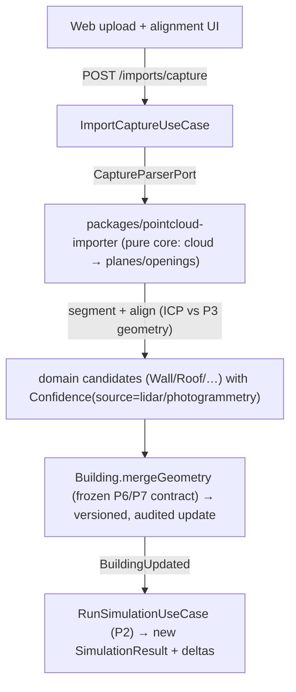

# Phase Overview

| Field | Value |
| --- | --- |
| Phase | P10 — Photogrammetry / LiDAR |
| Status | Planned |
| Team | 1 computer-vision engineer, 2 backend engineers, 1 3D specialist |
| Depends on | P3 exit (3D pipeline + coordinate system), P6/P7 merge-by-confidence contract; P9 optional (live twin) |
| Blocks | none — final enrichment phase of the current roadmap |

P10 ingests real-world 3D captures — photogrammetry meshes and LiDAR point clouds — and converts them into editable, confidence-tagged domain geometry that re-simulates through Open3CL.

# Objective

Accept a point cloud (E57/PLY/LAS) or photogrammetry mesh (OBJ/GLTF), segment walls/openings/roof, align it with the existing `Building` model, and produce updated envelope elements with `Confidence { source: "lidar" | "photogrammetry" }` — then re-simulate via the P2 pipeline.

# Business Value

- Field capture replaces inference: the most accurate geometry source for existing buildings that lack plans or IFC.
- Completes the digital twin loop: capture (P10) → model → simulate (P2) → monitor (P9).

# Scope

**In scope**

- `packages/pointcloud-importer`: load E57/PLY/LAS/OBJ/GLTF (size-capped, e.g., ≤ 2 GB clouds); downsampling to a working resolution (e.g., 2 cm voxels).
- Plane segmentation (RANSAC) for walls/floor/ceiling/roof; opening detection (holes in wall planes, window/door contours).
- Alignment: ICP/point-to-model registration against the existing 3D geometry (P3) when available; manual 3-point alignment fallback in the UI.
- Conversion: segmented planes → domain `Wall`/`Roof`/`Floor`/`Window`/`Door` candidates with per-element confidence (plane fit residual, point density).
- Merge into `Building` via the frozen merge-by-confidence contract (P6/P7): capture values are measured (high confidence) and override inferred ones; conflicts reported.
- Re-simulate through Open3CL; show before/after deltas.
- Report v4 (`capture` section: cloud stats, segmentation counts, alignment error, per-element confidence).

**Out of scope**

- Real-time capture from devices (mobile app capture UX is a separate product track), mesh *editing* beyond conversion (P4 editor applies after conversion).

# Functional Requirements

- FR-P10-01: Upload a point cloud or mesh (`POST /imports/capture`); receive segmentation preview + alignment error.
- FR-P10-02: User confirms/adjusts alignment (auto ICP result editable with 3-point fallback).
- FR-P10-03: Confirmed capture converts to domain elements, each with `Confidence { source: "lidar"|"photogrammetry", confidence }`.
- FR-P10-04: Merge updates the `Building` (audited, versioned like P4 edits) and triggers re-simulation; UI shows geometry + consumption deltas.
- FR-P10-05: Report lists unsegmented regions (e.g., cluttered areas) instead of guessing.

# Technical Requirements

- TR-P10-01: p95 processing < 5 min for a 50 M-point cloud on the reference GPU/CPU box; memory-capped streaming pipeline.
- TR-P10-02: Segmentation quality gates: wall plane fit residual threshold, minimum point density per element; failing elements are reported, not defaulted.
- TR-P10-03: Alignment: ICP against P3 geometry with max RMS error threshold (e.g., 5 cm); beyond threshold → manual alignment required.
- TR-P10-04: Importer core pure/framework-free; heavy compute isolated in a worker (job pattern from P2).
- TR-P10-05: ≥ 80% coverage on conversion/segmentation core; fixtures: ≥ 3 real room scans (LiDAR + photogrammetry).
- TR-P10-06: Security: parser sandboxed, size caps, fuzz tests on malformed files.

# Architecture

# Domain Model Impact

- `Confidence.source` gains `"lidar"` and `"photogrammetry"`.
- New value objects: `PointCloudStats`, `SegmentedPlane`, `AlignmentResult { method, rmsError }`, `CaptureReport`.
- `ImportReport` v4 with `capture` section.
- `Building.mergeGeometry` reused unchanged (contract frozen in P6/P7).

# Deliverables

1. `packages/pointcloud-importer` (loaders, downsampling, RANSAC segmentation, opening detection, ICP alignment) with fixtures.
2. Worker-based processing job (reuses P2 job pattern).
3. Web upload + alignment preview + confirm flow; report v4.
4. End-to-end demo: scan one room → merge → re-simulate → delta shown.
5. Doc: supported formats, resolution limits, accuracy expectations.

# Dependencies

**Must be completed before this phase starts:**

- P3 exit: deterministic 3D geometry + documented CRS (alignment target).
- P6 or P7 exit: `Building.mergeGeometry` contract frozen.
- P2 exit: simulation pipeline stable for before/after deltas.

# Test Plan

## Unit Tests

- Loaders per format (E57/PLY/LAS/OBJ/GLTF) on small synthetic clouds with known planes.
- RANSAC plane detection: synthetic room (4 walls + floor + ceiling) → correct planes, residuals below threshold.
- Opening detection: wall with rectangular hole → opening candidate with correct bounds.
- ICP alignment: known transform applied to synthetic cloud → recovered within 1 cm / 0.5°.

## Integration Tests

- Real fixture scan → job completes < 5 min → candidates produced → merge → building version incremented, audit entries written.
- Misaligned capture (RMS > 5 cm) → auto-alignment rejected → manual fallback required.
- Re-simulation after merge produces new `SimulationResult`; deltas computed correctly.

## Acceptance Tests

- AC-P10-01: ≥ 3 real room scans convert with ≥ 80% of major planes segmented (per-fixture ground truth).
- AC-P10-02: Alignment RMS < 5 cm on fixtures; manual fallback works in UI.
- AC-P10-03: Merged building re-simulates via Open3CL; UI shows before/after consumption (Playwright).
- AC-P10-04: Every converted element has confidence metadata; unsegmented regions reported (DB/report check).

# Risks

| Risk | Level | Mitigation |
| --- | --- | --- |
| Mesh/point-cloud quality too low (noise, clutter, reflective surfaces) | High | Quality gates + confidence per element; unsegmented regions reported; user confirmation step |
| File sizes and processing cost | Medium | Streaming, voxel downsampling, worker jobs, hard caps |
| Alignment drift corrupts the model | Medium | ICP RMS threshold + manual fallback; alignment error stored in report |
| Format zoo (E57/PLY/LAS/OBJ/GLTF variants) | Medium | Declared supported subset; others rejected with guidance; loaders behind a port |

# Acceptance Criteria

AC-P10-01…04 green on `main`; accuracy report published per fixture.

# Exit Criteria

**Roadmap completion:** capture pipeline stable; merge contract proven across DPE/PDF/IFC/LiDAR sources; every building re-simulates through Open3CL after any geometry update; reports v1–v4 all versioned and persisted.

# Branch Name

`feature/P10-photogrammetry`

# Definition of Done

- [ ] Fixture scans segment with measured accuracy; quality gates enforced
- [ ] ICP alignment verified < 5 cm RMS; manual fallback in UI
- [ ] Converted elements confidence-tagged; merge via frozen contract; audit + versioning
- [ ] Re-simulation via Open3CL with before/after deltas e2e-verified
- [ ] Report v4 persisted; hostile-file fuzz tests pass; coverage ≥ 80%; CI green
