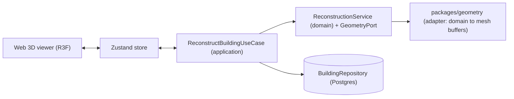

# Phase Overview

| Field | Value |
| --- | --- |
| Phase | P3 — 3D Reconstruction |
| Status | Planned |
| Team | 2 frontend engineers (R3F/Three.js), 1 backend engineer |
| Depends on | P1 exit criteria (buildings importable). Runs in parallel with P2 |
| Blocks | P4 (editor needs selectable 3D elements), P10 |

P3 reconstructs a navigable 3D model of the dwelling from the imported `Building`, including heat-loss visualization, in under 2 seconds.

Canonical prompt to start a Vibe session for this phase: [P3-vibe-prompt.md](P3-vibe-prompt.md).

# Objective

Render any imported building in 3D (walls, roof, floors, windows, doors, rooms) with per-element heat-loss coloring, reconstructing missing geometry from the DPE data and marking every inferred element visually.

# Business Value

- 3D is the product's differentiator: homeowners understand heat losses visually, not in tables.
- The 3D model is the substrate for the editor (P4) and for photogrammetry alignment (P10).

# Scope

**In scope**

- Geometry builder (domain service): `Building` → mesh data (`packages/domain` reconstruction rules + `packages/geometry` adapter).
- Web 3D viewer: React Three Fiber + Three.js, Zustand store, MUI panel.
- Camera/orbit controls, element picking, room labels, heat-loss overlay (from the latest `SimulationResult` when available, P2 merged).
- Confidence visualization: inferred elements rendered with a distinct hatch/color + tooltip showing `{ source, confidence }`.
- Performance: reconstruction < 2 s for a typical dwelling (≤ 300 m²).

**Out of scope**

- Editing (P4), PDF/IFC import (P6/P7), IoT (P9).

# Functional Requirements

- FR-P3-01: Given a `buildingId`, the web app renders its 3D model.
- FR-P3-02: Missing dimensions/orientations are inferred by documented rules; inferred elements are visually marked with their confidence.
- FR-P3-03: Clicking an element shows its properties (U-value, area, orientation, confidence) in a side panel.
- FR-P3-04: Heat-loss overlay colors envelope elements by their share of total losses (requires a `SimulationResult`; hidden otherwise).
- FR-P3-05: Reconstruction of a typical dwelling completes in < 2 s (measured from building fetch to first rendered frame).

# Technical Requirements

- TR-P3-01: Reconstruction < 2 s p95 on the fixture corpus (CI benchmark, headless).
- TR-P3-02: Rendering sustains 60 fps on a mid-range GPU for typical dwellings; geometry merged by material to limit draw calls.
- TR-P3-03: No business logic in components: components read from the Zustand store, which is fed by application services; reconstruction rules live in the domain, not in the view.
- TR-P3-04: Geometry is computed deterministically: same building → same mesh (hash check in tests).
- TR-P3-05: ≥ 80% coverage on the geometry/reconstruction packages; Playwright e2e for viewer smoke test.
- TR-P3-06: Coordinate system documented (meters, Z-up, origin at building footprint corner); unit-tested.

# Architecture

Heat-loss overlay data comes from `SimulationResult` (read-only projection); P3 does not calculate anything — Open3CL does (ADR-0001).

# Domain Model Impact

- New value objects: `Mesh`, `Face`, `Vector3`, `Dimensions`, `Orientation`.
- New domain service: `ReconstructionService` with versioned inference rules (`inferenceRulesVersion` recorded on the produced geometry).
- `Building` gains `reconstructGeometry(): Geometry` (domain behavior) — pure, no I/O.
- No new persistence tables (geometry is derived, cached client-side by building input hash).

# Deliverables

1. `packages/geometry` adapter + reconstruction rules in the domain, fully unit-tested.
2. R3F viewer with picking, properties panel, confidence marking, heat-loss overlay.
3. Zustand store + application service wiring.
4. Performance benchmark (< 2 s) in CI; Playwright e2e smoke test.
5. Doc: coordinate system + inference rules catalog.

# Dependencies

**Must be completed before this phase starts (P1 exit):** buildings importable and persisted; frozen fixtures available; `BuildingRepository` stable. P2 may still be in progress — the heat-loss overlay is simply hidden until a `SimulationResult` exists.

# Test Plan

## Unit Tests

- Reconstruction rules: complete building → exact geometry; incomplete building → inferred values with confidence flags and `inferenceRulesVersion`.
- Determinism: same input → identical mesh hash.
- Coordinate-system conversions.

## Integration Tests

- Fetch building from API → reconstruct → mesh buffer produced; API round-trip latency measured.
- Overlay: given a stored `SimulationResult`, element loss shares sum to 100%.

## Acceptance Tests

- AC-P3-01: p95 reconstruction < 2 s on the corpus (CI, headless).
- AC-P3-02: Viewer renders walls/roof/floor/openings for every fixture (screenshot diff per fixture in CI).
- AC-P3-03: Inferred elements are visually distinguishable and their tooltip shows source + confidence (Playwright).
- AC-P3-04: Clicking an element shows correct properties (Playwright, fixture with known values).

# Risks

| Risk | Level | Mitigation |
| --- | --- | --- |
| DPE geometry is too incomplete for a faithful 3D model | High | Inference rules with confidence display; never hide that elements are inferred; P6/P7/P10 enrich geometry later |
| Rendering performance on large buildings | Medium | Draw-call merging, LOD, benchmark in CI; cap element count with warning |
| Coordinate/orientation inconsistencies corrupt the model | Medium | Documented convention + unit tests; visual regression screenshots per fixture |
| R3F/Three.js version churn | Low | Pin versions; upgrade PRs run the screenshot suite |

# Acceptance Criteria

AC-P3-01…04 green on `main`; screenshot regression suite stored as CI artifacts.

# Exit Criteria

**Must be completed before P4 starts:**

1. Viewer renders every fixture building; p95 < 2 s published.
2. Element picking works — the editor (P4) can rely on stable element IDs.
3. Geometry pipeline deterministic and hash-verified.
4. Heat-loss overlay verified against a real `SimulationResult`.

# Branch Name

`feature/P3-3d-reconstruction`

# Definition of Done

- [ ] 3D viewer renders all fixture buildings, p95 reconstruction < 2 s
- [ ] Inferred elements marked with confidence; tooltips show source
- [ ] Element picking + properties panel working (Playwright-verified)
- [ ] Heat-loss overlay sums to 100% and matches SimulationResult
- [ ] Deterministic mesh hash per building; screenshot regression suite in CI
- [ ] Coverage ≥ 80% on geometry/domain reconstruction; no business logic in components
