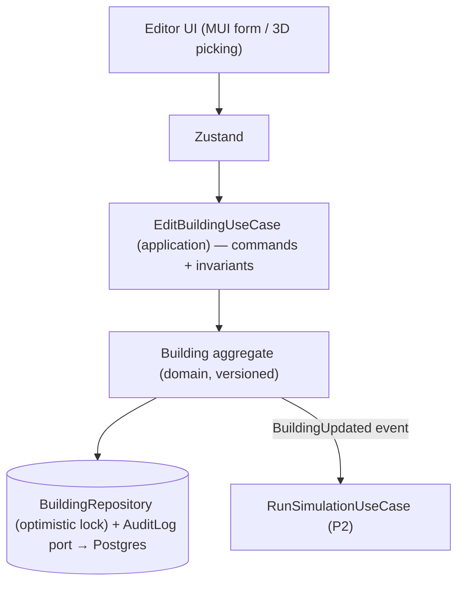

# Phase Overview

| Field | Value |
| --- | --- |
| Phase | P4 — Building Editor |
| Status | Planned |
| Team | 2 full-stack engineers, 1 domain expert |
| Depends on | P1 (buildings), P2 (re-simulation), P3 (selectable 3D elements) |
| Blocks | P5 (scenarios are sets of edits) |

P4 lets users correct and enrich the imported building: walls, openings, roof, floor, systems — every change validated, audited, and re-simulable.

Canonical prompt to start a Vibe session for this phase: [P4-vibe-prompt.md](P4-vibe-prompt.md).

# Objective

Provide a building editor (2D panel + 3D picking) where every modification is a validated domain command, persisted with an audit trail, marked `source: "user"` with high confidence, and immediately re-simulable through Open3CL.

# Business Value

- Imported DPE data is often wrong or outdated; letting users fix it makes the digital twin *their* building, not the diagnostician's snapshot.
- The editor is the entry point for renovation "what-if" editing, which powers scenarios (P5) and the AI advisor (P8).

# Scope

**In scope**

- Domain commands: `UpdateWall`, `UpdateWindow`, `UpdateRoof`, `UpdateFloor`, `UpdateHeatingSystem`, `UpdateVentilationSystem`, `AddRoom`, etc., each with invariant validation.
- Optimistic-concurrency-safe persistence (version/etag on `Building`) + audit log of every change (who/when/what old→new).
- Editor UI: select element in 3D or list → edit form (MUI) → validate → save → re-run simulation (P2) → updated labels.
- User-supplied values stored with `Confidence { source: "user", confidence: 1.0, importDate: now }`.
- Undo of the last change (command reversal from the audit log).

**Out of scope**

- Scenario branching (P5), PDF/IFC import (P6/P7), AI suggestions (P8).

# Functional Requirements

- FR-P4-01: User edits an envelope element or system via the UI; the change is validated against domain invariants before saving.
- FR-P4-02: Invalid edits are rejected with explicit, field-level messages.
- FR-P4-03: Every saved change is written to the audit log with timestamp, user, old value, new value, confidence metadata.
- FR-P4-04: After a successful edit, the user can trigger re-simulation; results reflect the edit (input hash changes → cache miss → new engine run).
- FR-P4-05: The last change can be undone.
- FR-P4-06: Concurrent edits to the same building are detected (HTTP 409) and resolved by the UI (reload + retry).

# Technical Requirements

- TR-P4-01: Commands are pure domain operations: `UpdateWallCommand → Either<DomainError, Building>`; no I/O in the domain.
- TR-P4-02: `Building` carries a version number; repository enforces optimistic locking.
- TR-P4-03: Audit log is append-only (separate table), queryable per building.
- TR-P4-04: p95 edit→persisted < 500 ms; re-simulation uses the P2 pipeline (p95 < 3 s).
- TR-P4-05: ≥ 80% coverage; JSDoc on public commands; Playwright e2e for edit→save→re-simulate.
- TR-P4-06: Domain event `BuildingUpdated` emitted per command.

# Architecture

# Domain Model Impact

- New command objects per editable element (e.g., `UpdateWallCommand { buildingId, wallId, uValue, thickness, material }`).
- `Building` gains `version: number` and `apply(command): Either<DomainError, Building>`.
- New entity `AuditEntry { buildingId, userId, timestamp, command, oldValue, newValue }`.
- User-edited fields wrapped in `Confidence { source: "user", confidence: 1.0 }`.
- New domain event: `BuildingUpdated`.

# Deliverables

1. Command set + invariant validation in the domain, with unit tests per invariant.
2. Optimistic-locking repository + append-only audit log (schema v3).
3. Editor UI (list + 3D picking + forms) with field-level validation errors.
4. Undo (last command) and 409 conflict handling.
5. E2E: edit wall U-value → re-simulate → consumption changes in the expected direction on a fixture.

# Dependencies

**Must be completed before this phase starts:**

- P1 exit: buildings importable/persisted; P2 exit: simulation API v1 stable, results historized; P3 exit: element picking with stable element IDs works.

# Test Plan

## Unit Tests

- Every command: valid input → new aggregate state + event; invalid input (e.g., negative U-value, window larger than wall) → typed `DomainError`, aggregate unchanged.
- Undo reconstructs the previous state from the audit entry.

## Integration Tests

- Save command → version increments; concurrent save with stale version → 409.
- Audit log rows written and retrievable; append-only enforced at DB level.
- Edit → input hash changes → P2 pipeline produces a new `SimulationResult` (no stale cache).

## Acceptance Tests

- AC-P4-01: Edit a wall's U-value in the UI on a fixture; re-simulate; consumption decreases and labels update in the UI (Playwright).
- AC-P4-02: Invalid edit (U-value = -1) is rejected with a field-level message; nothing persisted.
- AC-P4-03: Audit log shows the change with old/new values and `source: "user"`.
- AC-P4-04: Undo restores the previous values and triggers re-simulation.

# Risks

| Risk | Level | Mitigation |
| --- | --- | --- |
| Users enter physically invalid combinations | Medium | Domain invariants + field-level validation; never allow an un-simulable state to persist |
| Concurrent edits lose data | Low | Optimistic locking + 409 + UI retry; integration-tested |
| Audit log grows unbounded | Low | Retention policy; partitioning later |
| Re-simulation after each keystroke overloads the engine | Medium | Debounced explicit "re-simulate" action, not automatic per keystroke |

# Acceptance Criteria

AC-P4-01…04 green on `main`; command/invariant catalog documented.

# Exit Criteria

**Must be completed before P5 starts:**

1. Editor stable on `main`; command set covers all editable entities.
2. Audit log verified; undo verified.
3. Edit → re-simulate loop proven end-to-end with measurable consumption change on a fixture.
4. `Building` versioning + `BuildingUpdated` event contract frozen (P5 builds scenarios on top).

# Branch Name

`feature/P4-building-editor`

# Definition of Done

- [ ] Commands + invariants implemented and unit-tested (aggregate never enters invalid state)
- [ ] Optimistic locking (409) and append-only audit log working
- [ ] UI edit → save → re-simulate loop e2e-tested
- [ ] User edits stored with `source: "user"`, confidence 1.0
- [ ] Undo works; BuildingUpdated event emitted
- [ ] Coverage ≥ 80%, CI green
