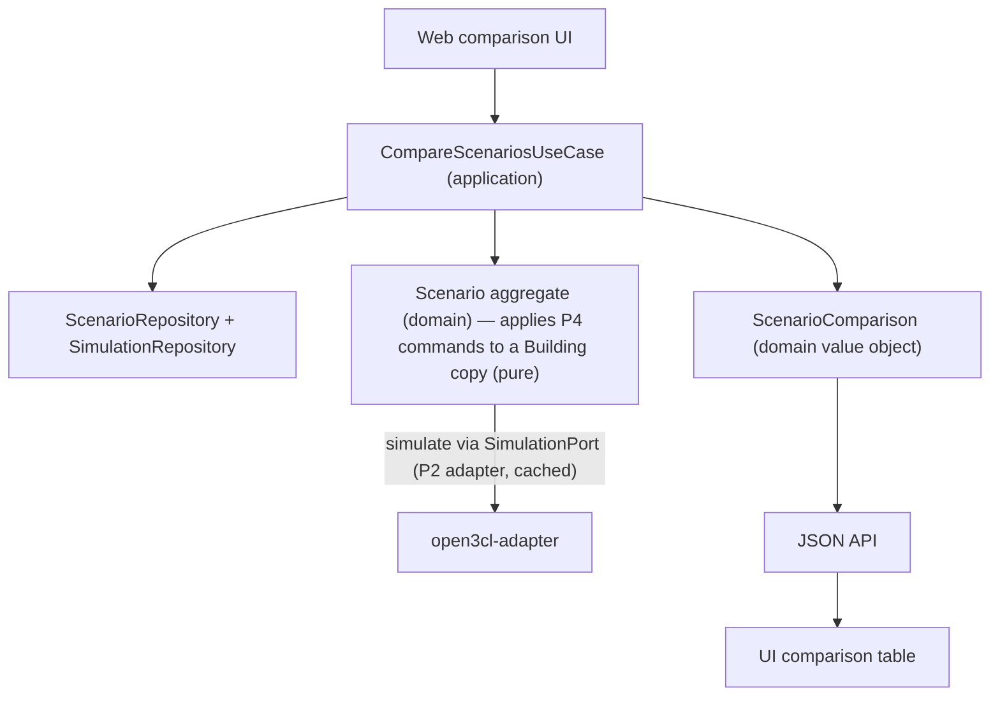

# Phase Overview

| Field | Value |
| --- | --- |
| Phase | P5 — Scenario Management |
| Status | Implemented on top of the merged P4 command vocabulary (round 2: rebased on P3+P4) — see the [comparison benchmark](P5-comparison-benchmark-report.md) |
| Team | 2 full-stack engineers, 1 product owner |
| Depends on | P2 exit (SimulationResult v1), P4 exit (editable, versioned Building) |
| Blocks | P8 (AI advisor ranks scenarios) |

P5 introduces renovation scenarios: named sets of modifications applied to a building, each simulated through Open3CL, and compared side by side in under 1 second.

Canonical prompt to start a Vibe session for this phase: [P5-vibe-prompt.md](P5-vibe-prompt.md).

## Round-2 notes (after the P3+P4 rebase)

- **Command vocabulary:** a scenario is a named change-set of P4 `BuildingCommand`s (frozen tags `building.<element>.update.v1`, `COMMAND_VOCABULARY_VERSION = 1` in `packages/domain/src/commands.ts`) applied to a copy of the building via `Building.fork(commands)` — the single shared contract with the P4 editor. `buildingId` is stamped server-side from the URL; the change-set is validated by forking before anything is persisted.
- **Single simulation kernel:** `runInlineSimulation` (cache → 409 in-flight → engine → persist) is the ONE shared inline path for the P2 baseline sync flow and all P5 scenario simulations — no parallel calculation path (ADR-0001). Scenario simulations are deliberately **never queued**: a scenario input is at most baseline-sized, and `POST /buildings/:id/compare` must answer synchronously. Trade-off, accepted and documented: a ~5 MB source DPE would make a scenario simulate an ~12 s inline HTTP request instead of returning 202 (the baseline endpoint keeps the queued path for such inputs).
- **Stale results are never served — by hash verification, not link bookkeeping:** before a linked `scenario_results` record is used, its `inputHash` is compared against `computeBuildingInputHash(building.fork(scenario.commands))`; on mismatch (PATCHed commands, or an apply that moved the baseline) the scenario is re-simulated inline through the shared pipeline and the fresh result is linked and served. `baseline_version` is stored but only surfaced as informational context in the comparison payload; it is never used as a staleness oracle.
- **Apply = the P4 path:** applying a scenario applies its commands one by one through `Building.apply` in a SINGLE optimistic-locked `BuildingRepository.update` transaction — +1 version per command, one append-only `audit_entries` row per command (schema v3, DB-enforced), `ScenarioApplied` event on top — then re-simulates the baseline through the shared pipeline (cache hit when the applied state equals a previously simulated scenario state).
- **Single overlay kernel:** the user-edit overlay in `packages/open3cl-adapter/src/map-building-to-engine-input.ts` is P4's (one implementation). It logs (never silently skips) a user-edited element id that matches no source-document entry, fails loudly (`SimulationMappingError`) on a user-sourced field the overlay does not cover, and a corpus-wide contract test pins the positional `wall-N → index N-1` mapping for every fixture. Windows need no saisie-method enum: the engine honors `uw_saisi` directly (`3.3_baie_vitree.js`), verified across the corpus.

# Objective

Let a user create scenarios ("Insulate walls", "Replace boiler + windows", …), run each through Open3CL, and compare consumption, emissions, labels, and estimated cost against the baseline — with comparison results delivered in under 1 second.

# Business Value

- Scenario comparison is the decision-making feature: it turns simulation from a report into a renovation roadmap.
- It is the quantitative backbone of the AI advisor (P8), which can only rank what has been simulated.

# Scope

**In scope**

- `Scenario` aggregate: name, description, list of modification commands (reusing P4 commands), baseline building version, status.
- CRUD endpoints: `POST /buildings/:id/scenarios`, `GET/PATCH/DELETE`, `POST /scenarios/:id/simulate`.
- `CompareScenariosUseCase`: runs (or reuses cached) simulations for baseline + scenarios and produces a `ScenarioComparison` (deltas in kWh, kg CO₂, label changes, cost estimate if cost data provided).
- Web UI: scenario list, comparison table + label badges per scenario, "apply scenario to building" action.
- Comparison p95 < 1 s (cached simulation results; comparison itself is pure domain computation).

**Out of scope**

- AI-generated recommendations (P8), cost database integration beyond a simple editable cost table, PDF export of comparisons.

# Functional Requirements

- FR-P5-01: Create a scenario from a set of edits (same commands as P4) applied on top of the current building.
- FR-P5-02: Simulate a scenario via Open3CL; result persisted and linked to the scenario.
- FR-P5-03: Compare any set of scenarios + baseline: per-scenario consumption, emissions, labels, deltas vs baseline, ranking by kWh saved.
- FR-P5-04: Comparison response p95 < 1 s when all results are cached.
- FR-P5-05: Applying a scenario writes its edits onto the building (audit-logged, source "user") and re-simulates the baseline.
- FR-P5-06: Deleting a scenario never deletes the building or other scenarios' results.

# Technical Requirements

- TR-P5-01: Scenario simulation reuses the P2 pipeline unchanged (same `SimulationPort`, same cache) — no parallel calculation engine.
- TR-P5-02: `ScenarioComparison` computed in the domain (pure function over `SimulationResult`s) — no I/O.
- TR-P5-03: Comparison p95 < 1 s for ≤ 10 scenarios, measured in CI.
- TR-P5-04: Schema v4: `scenarios`, `scenario_results` tables; scenario commands serialized as JSON with command-type tags (versioned).
- TR-P5-05: ≥ 80% coverage; Playwright e2e: create 2 scenarios → compare → table shows correct deltas on a fixture.
- TR-P5-06: Domain events: `ScenarioCreated`, `ScenarioSimulated`, `ScenarioApplied`.

# Architecture

# Domain Model Impact

- New aggregate `Scenario { id, buildingId, name, description, commands: Command[], baselineVersion, createdAt }`.
- New value object `ScenarioComparison { baseline, entries: [{ scenarioId, result, deltaKwh, deltaKg, labelChange, rank }] }`.
- New domain service `ComparisonService.compare(results): ScenarioComparison`.
- `Building` unchanged except a `fork(commands): Building` method used to materialize a scenario's state (pure).

# Deliverables

1. Scenario aggregate + CRUD endpoints + schema v4.
2. Simulation-per-scenario via the P2 pipeline; per-scenario result history.
3. `CompareScenariosUseCase` + comparison API (`POST /buildings/:id/compare`).
4. Web UI: scenario editor (reuse P4 forms), comparison table with labels and deltas.
5. CI benchmark for the < 1 s comparison budget.

# Dependencies

**Must be completed before this phase starts:**

- P2 exit: `SimulationResult` schema v1 frozen, simulation API stable, cache + jobs verified.
- P4 exit: command set + versioned `Building` + audit log + edit→re-simulate loop proven.

# Test Plan

## Unit Tests

- `Building.fork(commands)` applies commands without mutating the original.
- `ComparisonService`: deltas, ranking, label-change computation on synthetic results.
- Scenario serialization/deserialization (command tags round-trip).

## Integration Tests

- Create scenario with wall-insulation command on a fixture → simulate → result persisted → comparison endpoint returns correct delta vs baseline (recomputed independently in the test).
- Cache reuse: second comparison < 1 s and engine call counter unchanged.
- Apply scenario → building version increments, audit entries written.

## Acceptance Tests

- AC-P5-01: Comparison of baseline + 3 scenarios on a fixture returns in p95 < 1 s (cached) with correct deltas (Playwright + API assert).
- AC-P5-02: Label improvement shown correctly (e.g., D → C) in the UI.
- AC-P5-03: Apply scenario persists edits with audit trail and re-simulates baseline.
- AC-P5-04: Deleting a scenario leaves building and other results intact.

# Risks

| Risk | Level | Mitigation |
| --- | --- | --- |
| Many scenarios × simulations overload the engine/queue | Medium | Cache by input hash; queue with rate limit; comparison itself is free |
| Users misread deltas (baseline confusion) | Medium | UI always shows absolute values + deltas; baseline pinned and labeled |
| Command serialization breaks across versions | Low | Versioned command tags; migration tests |
| Cost estimates misleading | Low | Costs are user-editable inputs, labeled as estimates with confidence |

# Acceptance Criteria

AC-P5-01…04 green on `main`; comparison benchmark published.

# Exit Criteria

**Must be completed before P8 starts:**

1. Scenario CRUD + comparison API v1 stable and versioned.
2. `ScenarioComparison` schema frozen — P8 ranks over exactly this structure.
3. Comparison p95 < 1 s demonstrated in CI.
4. Audit trail verified for apply-scenario.

# Branch Name

`feature/P5-scenario-management`

# Definition of Done

- [ ] Scenario CRUD + simulate + compare endpoints working, API v1 versioned
- [ ] Comparison p95 < 1 s (cached results), deltas verified against independent recomputation
- [ ] UI comparison table with labels/deltas e2e-tested
- [ ] Apply scenario → audited building update + baseline re-simulation
- [ ] All simulations via Open3CL adapter only; coverage ≥ 80%; CI green
