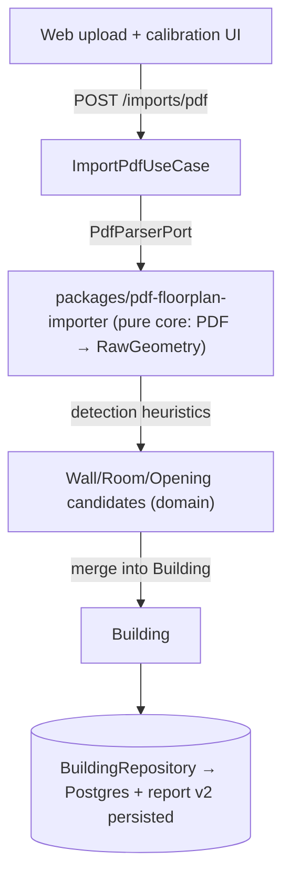

# Phase Overview

| Field | Value |
| --- | --- |
| Phase | P6 — PDF Import |
| Status | Planned |
| Team | 2 backend engineers, 1 computer-vision engineer |
| Depends on | P1 exit (domain model, confidence metadata, import report pattern) |
| Blocks | P10 (PDF plans complement photogrammetry) |

P6 imports PDF floorplans — vector or scanned — and converts them into domain geometry, with extraction confidence reported for every element.

# Objective

Extract room/wall/opening geometry from a PDF floorplan, let the user calibrate the scale, and merge the result into a `Building` — either standalone or as an enrichment of an existing DPE-imported building.

# Business Value

- Many dwellings have a PDF plan but an outdated or missing DPE; PDF import widens the addressable input set.
- Enriching a DPE-imported building with plan geometry directly improves 3D fidelity (P3) and simulation accuracy (P2), because inferred values get replaced by measured ones.

# Scope

**In scope**

- `packages/pdf-floorplan-importer`: vector extraction (lines, arcs, polylines, text) from native PDFs; raster fallback with OCR for scanned plans.
- Scale calibration UI: user picks two points of known distance.
- Wall/room/opening detection heuristics (wall thickness from parallel lines, door swings from arcs, window gaps).
- Merge strategy: imported plan geometry overrides inferred DPE geometry with `Confidence { source: "pdf-plan", confidence: per-element }`.
- Import report v2 (extends P1 report with an `extraction` section: element counts, confidence distribution, unresolved ambiguities).

**Out of scope**

- 3D rendering (P3), editing UI (P4), IFC (P7), LiDAR (P10).

# Functional Requirements

- FR-P6-01: Upload a PDF plan (`POST /imports/pdf`); receive extracted raw geometry + ambiguity list.
- FR-P6-02: User calibrates scale; all dimensions convert to meters.
- FR-P6-03: Detected walls/rooms/openings are mapped to domain entities and merged into a building (new or existing).
- FR-P6-04: Every extracted element carries `Confidence` with source `pdf-plan` (vector) or `pdf-ocr` (raster/OCR) and a per-element score.
- FR-P6-05: The import report lists unresolved ambiguities (e.g., unclear wall junctions) instead of guessing silently.

# Technical Requirements

- TR-P6-01: Vector path: parse PDF content streams (embedded fonts/images ignored for geometry); raster path: rasterize at 300 DPI, OCR + line detection.
- TR-P6-02: p95 extraction < 10 s for plans up to 20 pages; files up to 50 MB accepted.
- TR-P6-03: No extracted value is stored without confidence metadata; OCR-derived text has confidence < vector-derived geometry.
- TR-P6-04: Importer core is pure (PDF → geometry), framework-free; NestJS adapter thin.
- TR-P6-05: ≥ 80% coverage on the importer core; fixtures: ≥ 5 vector PDFs + ≥ 3 scanned PDFs.
- TR-P6-06: Security: PDF parser sandboxed (no external references, resource limits) — hostile-PDF fuzz tests.

# Architecture

# Domain Model Impact

- New entities/value objects: `RawGeometry`, `ExtractedWall`, `ExtractedRoom`, `ExtractedOpening`, `ScaleCalibration`.
- `Confidence.source` gains values `"pdf-plan"` and `"pdf-ocr"`.
- `ImportReport` v2 with `extraction` section.
- `Building.mergeGeometry(extracted, confidencePolicy)` domain method — extracted measured values replace inferred ones and raise confidence.

# Deliverables

1. `packages/pdf-floorplan-importer` (vector + raster/OCR paths) with fixture suite.
2. Calibration UI + merge flow in the web app.
3. Import report v2.
4. Postgres schema unchanged (confidence metadata already modeled); migration only if report shape needs columns.
5. Doc: detection heuristics catalog + limitations.

# Dependencies

**Must be completed before this phase starts:** P1 exit — domain model, `Confidence<T>`, import report pattern, repository stable.

# Test Plan

## Unit Tests

- Vector parsing: known PDF fixture → expected line/arc counts and coordinates (tolerance 0.5 mm at plan scale).
- Wall detection: parallel-line pairs → wall with thickness; door arcs → opening; text OCR fallback path.
- Scale calibration: two points + known distance → correct meter conversion.

## Integration Tests

- Upload PDF → extraction → merge into existing DPE building → inferred wall confidence replaced by `pdf-plan` values; report v2 persisted.
- Hostile PDF (nested objects, huge dimensions) → rejected safely, no crash.

## Acceptance Tests

- AC-P6-01: All vector fixtures extract with ≥ 90% of expected walls detected (per-fixture ground truth).
- AC-P6-02: Scanned fixtures extract with OCR confidence labels; p95 < 10 s.
- AC-P6-03: Merged building re-simulates (P2 pipeline) with updated geometry.
- AC-P6-04: Report lists ambiguities; nothing stored without confidence (DB-level check).

# Risks

| Risk | Level | Mitigation |
| --- | --- | --- |
| Rasterized/scanned PDFs dominate real-world input | High | OCR + line-detection fallback; confidence labels make quality visible; user calibration |
| Scale missing or wrong | Medium | Mandatory calibration step; sanity checks (room sizes plausibility) |
| OCR misreads dimensions | Medium | Low confidence + user review step before merge; never auto-applied silently |
| Hostile PDFs | Medium | Sandboxed parser, resource limits, fuzz tests |

# Acceptance Criteria

AC-P6-01…04 green on `main`; heuristics catalog documented.

# Exit Criteria

**Must be completed before P7 starts:** P6 may run in parallel with P7, but before P7's acceptance phase, the merge-into-building path must be proven (P7 also produces geometry merges). Concretely: extraction pipeline green on fixtures, report v2 versioned, `Building.mergeGeometry` contract frozen.

# Branch Name

`feature/P6-pdf-import`

# Definition of Done

- [ ] Vector + scanned PDF fixtures extract within budget; detection accuracy measured
- [ ] Scale calibration enforced; meter conversion tested
- [ ] Merge into building replaces inferred values with confidence-tagged ones
- [ ] Report v2 persisted; ambiguities listed; DB confidence check passes
- [ ] Hostile-PDF fuzz tests pass; coverage ≥ 80%; CI green
