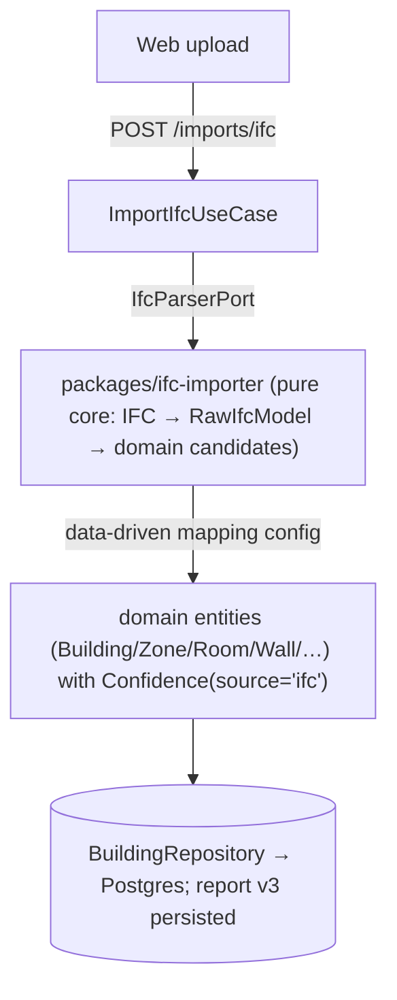

# Phase Overview

| Field | Value |
| --- | --- |
| Phase | P7 — IFC Integration |
| Status | Planned |
| Team | 2 backend engineers, 1 BIM specialist |
| Depends on | P1 exit; benefits from P6 merge path (geometry confidence) |
| Blocks | P10 alignment quality |

P7 imports IFC/OpenBIM models into the domain `Building`, so professionally modeled buildings (architects, BIM workflows) enter the platform without re-entry.

# Objective

Parse an IFC file (IFC2x3/IFC4), map its building elements to the domain model with confidence metadata, and produce a `Building` that can be visualized (P3) and simulated via Open3CL (P2).

# Business Value

- Opens the professional/BIM market: architects and engineering firms already hold IFC models.
- IFC carries richer, measured geometry than DPE XML — importing it raises model fidelity and confidence across the platform.

# Scope

**In scope**

- `packages/ifc-importer`: IFC parsing (schema-aware reader), mapping of `IfcBuilding`, `IfcSpace`, `IfcWall`, `IfcSlab`, `IfcRoof`, `IfcWindow`, `IfcDoor`, `IfcBuildingElementProxy` (as fallback), property sets (`Pset_WallCommon` U-values etc.).
- Unit/CRS handling: convert to the platform's documented coordinate system (meters, Z-up, project origin).
- Merge with existing building (from DPE/PDF) when an `ifcBuilding` identifier or geo match exists; conflicts resolved in favor of higher-confidence source, reported.
- Import report v3 (extends v2 with an `ifc` section: entity counts by type, unmapped entities list).
- Validation report: elements with missing required properties (e.g., wall without thickness) listed, not silently defaulted.

**Out of scope**

- IFC *export* (future), 3D editing (P4), simulation changes (P2 unchanged).

# Functional Requirements

- FR-P7-01: Upload an IFC file (`POST /imports/ifc`); receive mapped building + validation report.
- FR-P7-02: Supported IFC versions declared explicitly (IFC2x3 TC1, IFC4); unsupported versions rejected with a clear message.
- FR-P7-03: Mapped entities carry `Confidence { source: "ifc", confidence }` — IFC geometry is treated as measured (high) but property completeness is scored.
- FR-P7-04: Unmapped IFC entities are listed in the report with their IFC type; nothing is silently dropped.
- FR-P7-05: Imported building renders in the P3 viewer and simulates through the P2 pipeline.

# Technical Requirements

- TR-P7-01: IFC reader chosen for schema coverage and license (documented in an ADR); parsing is streaming/bounded — p95 parse < 30 s for files up to 200 MB.
- TR-P7-02: Mapping table IFC entity → domain entity is data-driven (config), unit-tested per entity type.
- TR-P7-03: Geometry conversion (CAD coordinates → platform CRS) unit-tested with known fixtures; round-trip error < 1 mm.
- TR-P7-04: Importer core pure/framework-free; NestJS adapter thin.
- TR-P7-05: ≥ 80% coverage on mapping; fixtures: ≥ 5 real IFC files (public test models + anonymized project files).
- TR-P7-06: Security: IFC parser sandboxed; hostile-file fuzz tests.

# Architecture

# Domain Model Impact

- `Confidence.source` gains `"ifc"`.
- `ImportReport` v3 with `ifc` section (entity counts, unmapped entities).
- New value objects: `IfcEntityRef { ifcType, globalId }` stored on mapped entities for traceability back to the source IFC object.
- `Building.mergeGeometry` reused from P6 for merging IFC geometry into DPE/PDF-derived buildings.

# Deliverables

1. `packages/ifc-importer` + mapping config + fixtures.
2. ADR-0002: choice of IFC reader library (schema coverage, license, performance).
3. CRS conversion + validation report; report v3.
4. Web upload flow + report view.
5. Doc: supported IFC versions, mapped entity table, known limitations.

# Dependencies

**Must be completed before this phase starts:** P1 exit (domain + confidence + report pattern). If P6 has landed, `Building.mergeGeometry` must be frozen (P6 exit); otherwise P7 defines it and P6 adapts.

# Test Plan

## Unit Tests

- Mapping per entity type: IfcWall (incl. `IfcWallStandardCase`), IfcSlab, IfcRoof, IfcWindow, IfcDoor, IfcSpace → correct domain entities, properties (U-value from Pset) mapped with confidence.
- CRS conversion round-trip < 1 mm error.
- Unsupported IFC version → typed rejection.

## Integration Tests

- Full fixture IFC → building persisted → retrievable; report v3 lists all unmapped entities.
- Merge: IFC geometry + DPE building → conflict resolution by confidence, reported.
- Imported building renders (P3) and simulates (P2) without code changes to those phases.

## Acceptance Tests

- AC-P7-01: All IFC fixtures import; ≥ 95% of wall/slab/opening entities mapped (per-fixture ground truth).
- AC-P7-02: p95 parse < 30 s; 200 MB file handled within memory limits.
- AC-P7-03: Nothing stored without confidence; unmapped entities all reported (DB/report check).
- AC-P7-04: Imported building simulates via Open3CL and renders in 3D (e2e).

# Risks

| Risk | Level | Mitigation |
| --- | --- | --- |
| IFC vendor variance (different writers, schema drift) | High | Fixture suite from multiple tools; unmapped-entity reporting; per-version support statement |
| Large files / memory blow-up | Medium | Streaming parse, hard memory cap, clear error |
| Wrong CRS/units silently corrupt geometry | Medium | CRS conversion tests; visual check in 3D viewer during acceptance |
| Property sets missing (no U-values) | Medium | Validation report; fall back to documented defaults with low confidence, never silently |

# Acceptance Criteria

AC-P7-01…04 green on `main`; ADR-0002 accepted; mapping table published.

# Exit Criteria

**Must be completed before P8/P9/P10 rely on imports:** import report v3 versioned; `IfcEntityRef` traceability stored; merge-by-confidence contract frozen (shared with P6); imported buildings demonstrably simulate (P2) and render (P3).

# Branch Name

`feature/P7-ifc-import`

# Definition of Done

- [ ] IFC fixtures import with ≥ 95% entity mapping; report lists 100% of unmapped entities
- [ ] CRS/units conversion verified < 1 mm round-trip error
- [ ] All stored values confidence-tagged; validation report complete
- [ ] Imported building renders in 3D and simulates via Open3CL unchanged
- [ ] ADR-0002 accepted; hostile-file fuzz tests pass; coverage ≥ 80%; CI green
