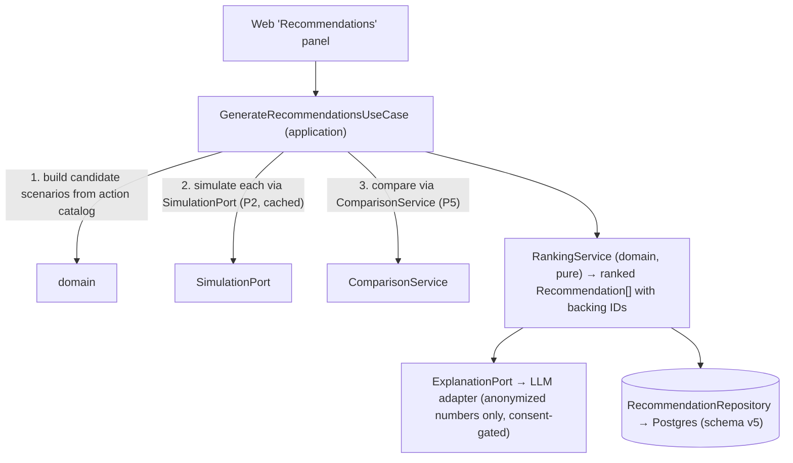

# Phase Overview

| Field | Value |
| --- | --- |
| Phase | P8 — AI Renovation Advisor |
| Status | Planned |
| Team | 2 backend engineers, 1 ML engineer, 1 legal/privacy reviewer |
| Depends on | P2 exit (SimulationResult v1), P5 exit (ScenarioComparison frozen) |
| Blocks | none — value-added layer on top of simulation |

P8 adds AI-assisted renovation recommendations. The hard rule: **the AI may rank and explain, but only Open3CL-computed deltas may justify a recommendation.**

# Objective

Generate renovation action recommendations that are each backed by a computed `ScenarioComparison` delta (kWh, CO₂, label change, cost), ranked transparently, and presented with a confidence score — never a free-text promise.

# Business Value

- Turns comparison tables into an actionable plan for non-expert homeowners.
- Differentiator vs plain DPE tools; drives conversion to renovation works.

# Scope

**In scope**

- Recommendation catalog: predefined renovation actions (wall insulation, roof insulation, window replacement, boiler replacement, ventilation upgrade, PV installation…) each mapped to domain commands (P4) so they can be turned into scenarios (P5) automatically.
- For each candidate action: auto-create scenario, simulate via Open3CL (P2 pipeline), compute comparison (P5), then rank by kWh saved per € (configurable weighting).
- LLM layer used only for *explanation text* of already-computed numbers; the model receives anonymized numeric deltas, never raw personal DPE data, unless the user explicitly consents.
- `Recommendation` entity: `{ actionId, scenarioId, computedImpact, explanation, confidence, source: "open3cl+advisor" }` — every recommendation traces to a `SimulationResult`.
- UI: "Recommended actions" panel on the building page, with per-action impact, cost, label change, confidence, and "simulate as scenario" button.
- Audit: every generated recommendation persisted with its backing simulation IDs.

**Out of scope**

- Autonomous execution of anything; works scheduling; direct integration with contractors.

# Functional Requirements

- FR-P8-01: `GET /buildings/:id/recommendations` returns ranked recommendations, each with a link to its backing scenario + simulation.
- FR-P8-02: No recommendation is returned without a computed `SimulationResult` behind it (enforced server-side; DB check possible).
- FR-P8-03: Each recommendation carries a confidence score derived from input data confidence (low-confidence building data → lower recommendation confidence) and from scenario coverage.
- FR-P8-04: Explanation text is generated from the computed numbers only; it must not introduce figures that are not in the `SimulationResult`/`ScenarioComparison`.
- FR-P8-05: Users can adjust ranking weights (cost vs kWh vs CO₂) and get a re-ranked list without new simulations.

# Technical Requirements

- TR-P8-01: Ranking logic is domain code (pure), unit-tested; the LLM is an adapter behind an `ExplanationPort` and can be swapped/mocked in tests.
- TR-P8-02: Privacy: default is local/no-external-LLM mode; if an external LLM is used, only anonymized aggregates are sent, with explicit user consent, and recorded in the audit log (GDPR).
- TR-P8-03: p95 recommendation generation (simulations cached) < 10 s; re-ranking < 200 ms (no engine calls).
- TR-P8-04: Hallucination guard: explanation text is template-filled from computed fields; numeric claims validated against the backing result by a checker (regex/parse + compare); any mismatch → recommendation suppressed and logged.
- TR-P8-05: ≥ 80% coverage; prompt versions pinned and stored with each recommendation.
- TR-P8-06: Schema v5: `recommendations` table with `backingSimulationId` FK (non-nullable).

# Architecture

Open3CL remains the only source of impact numbers (ADR-0001); the LLM never computes energy figures.

# Domain Model Impact

- New entity `Recommendation { id, buildingId, actionId, scenarioId, backingSimulationId, impact, explanation, confidence, promptVersion, createdAt }`.
- New value objects: `RenovationAction` (catalog entry → command template), `Impact { kwh, kgCo2, labelChange, costEur }`.
- New domain service `RankingService` with configurable weights.
- `Confidence.source` gains `"advisor"` for the recommendation-level confidence.

# Deliverables

1. Action catalog (≥ 8 renovation actions) mapped to P4 commands; each action has a fixture test that produces a scenario and simulates it.
2. `GenerateRecommendationsUseCase` + `POST/GET` endpoints + schema v5.
3. Ranking service + re-rank endpoint (no simulations).
4. LLM explanation adapter with anonymization, consent gate, and numeric-claim checker; ADR-0003 for the LLM/privacy decision.
5. Web recommendations panel.
6. Hallucination guard tests + privacy review sign-off.

# Dependencies

**Must be completed before this phase starts:**

- P2 exit: `SimulationResult` v1 frozen; simulation pipeline proven.
- P5 exit: `ScenarioComparison` schema frozen; scenario CRUD + comparison API v1 stable; apply-scenario audited.

# Test Plan

## Unit Tests

- Ranking: given synthetic comparisons, ordering respects weights; ties deterministic.
- Confidence propagation: building with many inferred fields → lower recommendation confidence.
- Numeric-claim checker: explanation containing a figure not in the result → suppressed.

## Integration Tests

- Generate recommendations on a fixture building: every returned recommendation has a non-null `backingSimulationId` pointing to a real `SimulationResult` (DB join check).
- Re-rank with different weights: same backing simulations, different order, zero engine calls.
- Consent off + external LLM configured → no external call made (adapter mock asserts).

## Acceptance Tests

- AC-P8-01: Recommendations panel shows ranked actions with impact + label change matching the scenario comparison exactly (Playwright + API cross-check).
- AC-P8-02: 100% of recommendations traceable to a `SimulationResult` (DB query).
- AC-P8-03: Explanation text contains only figures present in the backing result (automated checker over all generated explanations).
- AC-P8-04: Re-ranking p95 < 200 ms without engine calls (engine call counter = 0).

# Risks

| Risk | Level | Mitigation |
| --- | --- | --- |
| LLM hallucination produces false claims | High | Template-filled explanations + numeric-claim checker + suppression; LLM never sees raw personal data by default |
| Privacy/GDPR breach via DPE data sent to LLM provider | High | Anonymized aggregates only; explicit consent; audit log; ADR-0003; DPIA |
| Recommendation confidence overstated | Medium | Confidence derived from input-data confidence; displayed prominently |
| Cost data unreliable → bad ranking | Medium | Costs user-editable, labeled estimates; sensitivity shown |

# Acceptance Criteria

AC-P8-01…04 green on `main`; ADR-0003 accepted; privacy sign-off recorded.

# Exit Criteria

**Must be completed before P9 starts:** recommendations API v1 stable; `backingSimulationId` traceability guaranteed at DB level; hallucination guard tested; privacy mode (local default) verified. P9 (IoT) may then use recommendations to flag measured deviations.

# Branch Name

`feature/P8-ai-renovation-advisor`

# Definition of Done

- [ ] ≥ 8 catalog actions auto-convert to scenarios and simulate via Open3CL
- [ ] 100% of recommendations traceable to a SimulationResult (FK + test)
- [ ] Explanation checker suppresses any unbacked figure
- [ ] Ranking pure + re-rank < 200 ms with zero engine calls
- [ ] Consent-gated anonymized LLM path; audit log; ADR-0003 accepted
- [ ] Coverage ≥ 80%; CI green
