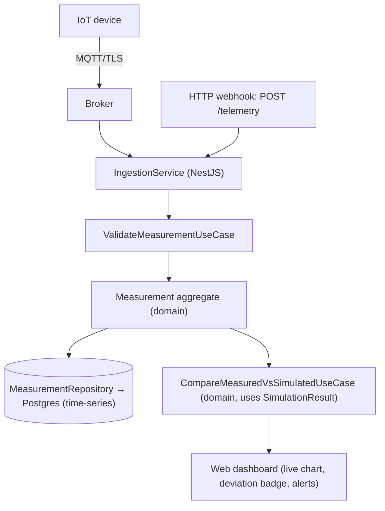

# Phase Overview

| Field | Value |
| --- | --- |
| Phase | P9 — IoT Digital Twin |
| Status | Planned |
| Team | 2 backend engineers, 1 IoT engineer, 1 legal/privacy reviewer |
| Depends on | P2 exit (SimulationResult v1) as the reference; benefits from P8 |
| Blocks | none — extends the twin with live data |

P9 connects real consumption telemetry to the digital twin: simulated vs measured, deviation alerts, and ground-truth feedback that improves model confidence.

# Objective

Ingest energy telemetry from connected devices (smart meters, sub-metering plugs) via MQTT/HTTP, store it as `Measurement`s, and show a live dashboard comparing measured consumption against the Open3CL simulation, with deviation alerts.

# Business Value

- Closes the loop between the regulatory model and reality — the "twin" in Digital Twin.
- Deviations reveal model errors (bad U-value assumptions) and real-world waste; both improve recommendations.

# Scope

**In scope**

- Telemetry ingestion: MQTT broker + HTTP webhook receiver behind the API; device registry (`Device { id, buildingId, type, consentScope, apiKeyHash }`).
- Explicit per-device consent: user grants which data may be stored/used; consent recorded and revocable; retention configurable.
- `Measurement` entity: `{ deviceId, timestamp, kwh, powerW?, source }` — time-series stored in Postgres (hypertable-ready) or TimescaleDB-compatible schema.
- Aggregation service: hourly/daily/monthly kWh per building.
- Comparison service (domain): measured vs simulated (`SimulationResult` extrapolated to the period), deviation % and threshold alerts.
- Dashboard: live chart, deviation badge, alert list; "mark model as under/over-estimating" feedback that lowers/raises confidence on relevant inferred fields.
- Data export (GDPR): user can export/delete all their measurements.

**Out of scope**

- Device control/actuation, billing integration, third-party device clouds beyond MQTT/HTTP ingestion.

# Functional Requirements

- FR-P9-01: Register a device for a building with explicit consent scope; receive credentials (scoped, revocable).
- FR-P9-02: Devices push measurements via MQTT or HTTP; invalid/auth-less pushes rejected.
- FR-P9-03: Dashboard shows measured vs simulated consumption over selectable periods, with deviation %.
- FR-P9-04: Alert when |deviation| > configurable threshold (default 15%) for 2 consecutive weeks.
- FR-P9-05: User can export or delete all personal telemetry (GDPR Art. 17/20).
- FR-P9-06: Feedback action: "actual consumption is higher" → flags relevant inferred fields for review (confidence adjusted, event emitted).

# Technical Requirements

- TR-P9-01: Ingestion p95 < 500 ms per message; sustained 1 000 msg/s on reference hardware (load test).
- TR-P9-02: MQTT broker (e.g., Mosquitto) + API webhook behind auth; TLS everywhere; per-device scoped tokens.
- TR-P9-03: Time-series schema designed for TimescaleDB hypertables (plain Postgres-compatible first).
- TR-P9-04: Deviation computation is domain code (pure), unit-tested; simulation side uses the latest `SimulationResult` — never a re-implementation (ADR-0001).
- TR-P9-05: Privacy: DPIA completed; data minimization (store kWh, not raw high-frequency data unless needed); encryption at rest; retention default 24 months, user-configurable.
- TR-P9-06: ≥ 80% coverage; Playwright e2e for dashboard with seeded measurements.

# Architecture

# Domain Model Impact

- New aggregates/entities: `Device`, `Consent { scope, grantedAt, revokedAt }`, `Measurement`, `DeviationAlert`.
- `Building` gains `measurements` read-model and `recordFeedback()` behavior adjusting confidence of inferred fields.
- New domain events: `MeasurementIngested`, `DeviationDetected`, `ConsentRevoked` (triggers purge job).

# Deliverables

1. Device registry + consent management (schema v6) + scoped credentials.
2. MQTT + HTTP ingestion with auth, validation, load test (1 000 msg/s).
3. Measurement storage (time-series-ready schema) + aggregation queries.
4. Deviation computation + alerts + dashboard UI.
5. GDPR export/delete endpoints + DPIA document.
6. Feedback loop into confidence metadata.

# Dependencies

**Must be completed before this phase starts:** P2 exit — `SimulationResult` v1 frozen and reproducible (the simulation side of the comparison must be stable before live data is compared against it).

# Test Plan

## Unit Tests

- Measurement validation (negative kWh, future timestamps, unknown device → rejected).
- Aggregation: hourly/daily/monthly sums on synthetic series.
- Deviation: measured vs simulated → correct %, threshold logic (15%/2 weeks), alert raised/cleared.
- Consent: revoked consent → ingestion rejects + purge job deletes stored data.

## Integration Tests

- MQTT publish from a test client → measurement persisted → appears in aggregation API.
- Load test: 1 000 msg/s sustained, p95 < 500 ms, no loss.
- Deviation flow: seed 3 weeks of high measurements + one SimulationResult → alert created → dashboard shows badge.

## Acceptance Tests

- AC-P9-01: Pilot device (simulated meter) streams live data; dashboard shows measured vs simulated within 5 min of ingestion (Playwright).
- AC-P9-02: Deviation > 15% for 2 weeks triggers exactly one alert; clearing works.
- AC-P9-03: Consent revocation → device credentials invalid immediately; stored measurements purged (verified in DB).
- AC-P9-04: GDPR export returns all user data; delete removes it (DB-level verification).

# Risks

| Risk | Level | Mitigation |
| --- | --- | --- |
| Privacy/GDPR breach (telemetry is personal data) | High | DPIA, consent scopes, minimization, encryption, purge on revocation, legal review before launch |
| Device protocol heterogeneity | Medium | Start with MQTT + HTTP only; adapter per protocol behind a port |
| Ingestion volume / downtime | Medium | Queue buffering, backpressure, load-tested broker, alerting |
| Simulated-vs-measured mismatch misinterpreted as engine error | Medium | Deviation dashboard explains factors (weather, occupancy); never silently "corrects" Open3CL results (ADR-0001) |

# Acceptance Criteria

AC-P9-01…04 green on `main`; DPIA signed; load test report published.

# Exit Criteria

**Must be completed before P10 starts:** telemetry pipeline stable (ingestion, storage, deviation, alerts); consent/purge verified; `Measurement` schema tagged v1. P10 (photogrammetry) can then enrich geometry while P9 keeps the twin live.

# Branch Name

`feature/P9-iot-digital-twin`

# Definition of Done

- [ ] MQTT + HTTP ingestion with scoped auth; 1 000 msg/s load test passed
- [ ] Measured vs simulated dashboard live; deviation alerts working
- [ ] Consent grant/revoke + purge verified at DB level; GDPR export/delete working
- [ ] Simulation side uses SimulationResult only (ADR-0001 respected)
- [ ] Coverage ≥ 80%; CI green; DPIA signed
